# Healthcare AI & Genomic Data Lake Architecture Specification

This document details the multi-tier microsegmentation, cryptographic boundaries, and topological graph formulation for the Healthcare AI & Genomic Telemedicine Data Lake.

---

## 1. Network Microsegmentation & Tier Isolation

The architecture isolates clinical workloads into four security zones across Dual Availability Zones (`us-east-1a` and `us-east-1b`):

### 1.1 Ingress DMZ Tier
* **Subnets:** `aws_subnet.telehealth_ingress_a` (`10.80.1.0/24`), `aws_subnet.telehealth_ingress_b` (`10.80.2.0/24`).
* **Security Group:** `aws_security_group.telehealth_alb_sg`.
* **Routing:** Direct route to `aws_internet_gateway.healthcare_igw` via `aws_route_table.public_rt`.
* **Function:** Public load balancers terminating patient TLS connections for video consultations and FHIR endpoints.

### 1.2 Telehealth Application Tier (Private)
* **Subnets:** `aws_subnet.telehealth_app_a` (`10.80.10.0/24`), `aws_subnet.telehealth_app_b` (`10.80.20.0/24`).
* **Security Group:** `aws_security_group.telehealth_app_sg`.
* **Function:** API microservices managing patient scheduling, clinical notes, and session state.

### 1.3 Genomic AI Processing Tier (Private Compute)
* **Subnets:** `aws_subnet.genomic_ai_a` (`10.80.30.0/24`), `aws_subnet.genomic_ai_b` (`10.80.40.0/24`).
* **Security Group:** `aws_security_group.genomic_ai_sg`.
* **Compute Instance:** `aws_instance.genomic_worker_a` (GPU accelerated `g5.4xlarge`).
* **Function:** Variant calling, secondary genomic analysis, and deep neural network model training on DNA sequencing data.

### 1.4 ePHI Database Tier (Private Isolated Vault)
* **Subnets:** `aws_subnet.ephi_db_a` (`10.80.50.0/24`), `aws_subnet.ephi_db_b` (`10.80.60.0/24`).
* **Subnet Group:** `aws_db_subnet_group.ephi_db_subnets`.
* **Security Group:** `aws_security_group.ephi_db_sg`.
* **Function:** Multi-AZ PostgreSQL repository (`aws_db_instance.ephi_postgresql_db`) hosting electronic health records. Zero direct egress to public networks.

---

## 2. Cryptographic Envelope Strategy

* **ePHI Master Key:** `aws_kms_key.ephi_kms_key` with alias `alias/healthcare-ephi-key`. Enforces mandatory automated annual key rotation per HIPAA §164.312(a)(2)(iv) and HITRUST 01.i.
* **Genomic DNA Key:** `aws_kms_key.genomic_kms_key` providing independent cryptographic isolation for genetic code assets under GDPR Article 9.
* **Audit Trail Envelope:** Encrypts multi-region event logging generated by `aws_cloudtrail.hipaa_cloudtrail`.

---

## 3. Dependency Directed Acyclic Graph (DAG)

```mermaid
graph TD
    VPC["aws_vpc.healthcare_vpc (CRITICAL_ROOT)"]
    IGW["aws_internet_gateway.healthcare_igw"]
    PublicSubA["aws_subnet.telehealth_ingress_a"]
    PublicSubB["aws_subnet.telehealth_ingress_b"]
    AppSubA["aws_subnet.telehealth_app_a"]
    AppSubB["aws_subnet.telehealth_app_b"]
    GenomicSubA["aws_subnet.genomic_ai_a"]
    GenomicSubB["aws_subnet.genomic_ai_b"]
    DBSubA["aws_subnet.ephi_db_a"]
    DBSubB["aws_subnet.ephi_db_b"]
    
    PublicRT["aws_route_table.public_rt"]
    PublicAssocA["aws_route_table_association.ingress_a_assoc"]
    PublicAssocB["aws_route_table_association.ingress_b_assoc"]
    
    AlbSG["aws_security_group.telehealth_alb_sg"]
    AppSG["aws_security_group.telehealth_app_sg"]
    GenomicSG["aws_security_group.genomic_ai_sg"]
    DBSG["aws_security_group.ephi_db_sg"]
    
    DBSubnetGroup["aws_db_subnet_group.ephi_db_subnets"]
    EphiDB["aws_db_instance.ephi_postgresql_db"]
    
    EphiKMS["aws_kms_key.ephi_kms_key"]
    EphiAlias["aws_kms_alias.ephi_kms_alias"]
    GenomicKMS["aws_kms_key.genomic_kms_key"]
    
    GenomicsS3["aws_s3_bucket.raw_genomics_lake"]
    ResearchS3["aws_s3_bucket.clinical_research_lake"]
    AuditS3["aws_s3_bucket.hipaa_audit_logs"]
    CloudTrail["aws_cloudtrail.hipaa_cloudtrail"]
    
    IAMRole["aws_iam_role.genomic_worker_role"]
    IAMPolicy["aws_iam_policy.genomic_processor_policy"]
    IAMAttach["aws_iam_role_policy_attachment.genomic_worker_attach"]
    IAMProfile["aws_iam_instance_profile.genomic_worker_profile"]
    WorkerA["aws_instance.genomic_worker_a"]
    
    VPC --> IGW
    VPC --> PublicSubA
    VPC --> PublicSubB
    VPC --> AppSubA
    VPC --> AppSubB
    VPC --> GenomicSubA
    VPC --> GenomicSubB
    VPC --> DBSubA
    VPC --> DBSubB
    VPC --> PublicRT
    VPC --> AlbSG
    VPC --> AppSG
    VPC --> GenomicSG
    VPC --> DBSG
    
    IGW --> PublicRT
    PublicRT --> PublicAssocA
    PublicRT --> PublicAssocB
    PublicSubA --> PublicAssocA
    PublicSubB --> PublicAssocB
    
    AlbSG --> AppSG
    AppSG --> GenomicSG
    AppSG --> DBSG
    GenomicSG --> DBSG
    
    DBSubA --> DBSubnetGroup
    DBSubB --> DBSubnetGroup
    DBSubnetGroup --> EphiDB
    DBSG --> EphiDB
    
    EphiKMS --> EphiAlias
    
    AuditS3 --> CloudTrail
    
    IAMPolicy --> IAMAttach
    IAMRole --> IAMAttach
    IAMRole --> IAMProfile
    
    GenomicSubA --> WorkerA
    GenomicSG --> WorkerA
    IAMProfile --> WorkerA
```

